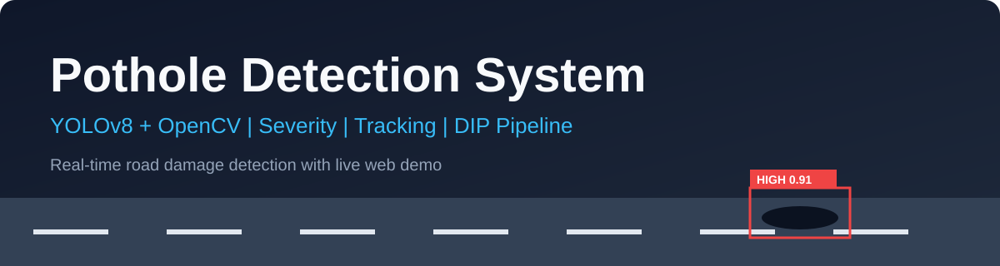
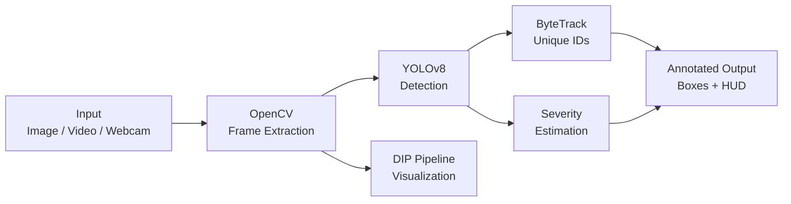

<div align="center">

# 🕳️ Pothole Detection System

### Real-time road damage detection with **YOLOv8 + OpenCV**
Detection • Severity Estimation • Unique Counting • DIP Pipeline • Live Web Demo




<!-- Demo GIF ready hone par ye line uncomment karo (file: demo.gif)

-->

[🎥 Live Demo](#) · [📂 Dataset](#dataset) · [🚀 Quick Start](#-quick-start) · [📊 Results](#-results)

</div>

---

## 📌 Problem Statement
Potholes cause accidents, vehicle damage and costly repairs. Manual road surveys are slow and subjective. This project automates pothole detection from images, videos and live camera feeds, and estimates how severe each pothole is — helping prioritise road maintenance.

## ✨ Features

| Feature | Description |
|---|---|
| 🎯 **Real-time detection** | YOLOv8 detects potholes on images, videos and webcam |
| ⚠️ **Severity estimation** | Each pothole tagged **LOW / MEDIUM / HIGH** using box-area ÷ frame-area |
| 🔢 **Unique counting** | ByteTrack assigns IDs so one pothole is counted only once |
| 🧪 **DIP pipeline view** | Grayscale → Gaussian Blur → Canny → Morphology → Contours, shown step by step |
| 📟 **Live HUD** | On-screen total count, severity split and FPS |
| 🌐 **Web demo** | Gradio app (image + video tabs), deployable on HuggingFace Spaces |

## 🧠 How It Works



**Severity logic**

| Box area / Frame area | Severity |
|---|---|
| < 2% | 🟢 LOW |
| 2% – 8% | 🟠 MEDIUM |
| > 8% | 🔴 HIGH |

> ⚠️ Severity is an *estimate* — it depends on camera height, distance and angle.

## 🛠️ Tech Stack

| Area | Tools |
|---|---|
| Language | Python |
| Computer Vision | OpenCV, NumPy |
| Deep Learning | Ultralytics YOLOv8, PyTorch |
| Tracking | ByteTrack |
| Demo / UI | Gradio |
| Training | Google Colab (T4 GPU) |

## 📁 Project Structure

```
pothole-detection/
├── train.py             # (optional) train your own YOLOv8 model
├── detect.py            # video / webcam inference
├── app.py               # Gradio web demo
├── utils.py             # severity, tracking, filters, HUD, DIP pipeline
├── requirements.txt
├── banner.svg
└── README.md
```

## 🚀 Quick Start

**1. Clone & install**
```bash
git clone https://github.com/yritu8095-sys/pothole-detection.git
cd pothole-detection
pip install -r requirements.txt
```

**2. Get the model** — see [Model](#-model) below (or train your own with `python train.py --data data.yaml`).

**3. Run**
```bash
python detect.py --source road.mp4          # saves output.mp4
python detect.py --source 0 --show          # live webcam
python app.py                               # web demo at localhost:7860
```

## 🧠 Model
This project uses the public pre-trained model **`keremberke/yolov8n-pothole-segmentation`** from HuggingFace (credit: *keremberke* — please check the model page for its license).
The pipeline built around it — tracking-based unique counting, severity estimation, false-positive filtering (size + region rules), DIP visualization and the web demo — is my own work.

```python
from huggingface_hub import hf_hub_download
import os, shutil
os.makedirs("models", exist_ok=True)
shutil.copy(hf_hub_download("keremberke/yolov8n-pothole-segmentation", "best.pt"), "models/best.pt")
```

<a name="dataset"></a>
## 📂 Dataset
Pothole images in YOLOv8 format from [Roboflow Universe](https://universe.roboflow.com) / Kaggle.
Only needed if you train your own model with `train.py`.

## 📊 Results

Tested on a road video I recorded myself with a phone.

| Item | Value |
|---|---|
| Test video | _[X] sec, phone recording_ |
| Unique potholes detected | _[N]_ |
| Speed | ~16 FPS (Colab T4 GPU) |

## 🔮 Future Improvements
- [ ] GPS tagging + map dashboard for pothole locations
- [ ] Automatic reporting to authorities
- [ ] Depth-based (true) severity measurement
- [ ] Mobile / edge deployment (TFLite, ONNX)
- [ ] Night and rain robustness

## 🤝 Contributing
Issues and pull requests are welcome.

## 📜 License
Released under the MIT License.

## 👩‍💻 Author
**Ritu** — [GitHub](https://github.com/yritu8095-sys) · [LinkedIn](#)

<div align="center">⭐ If you found this useful, please star the repo!</div>
